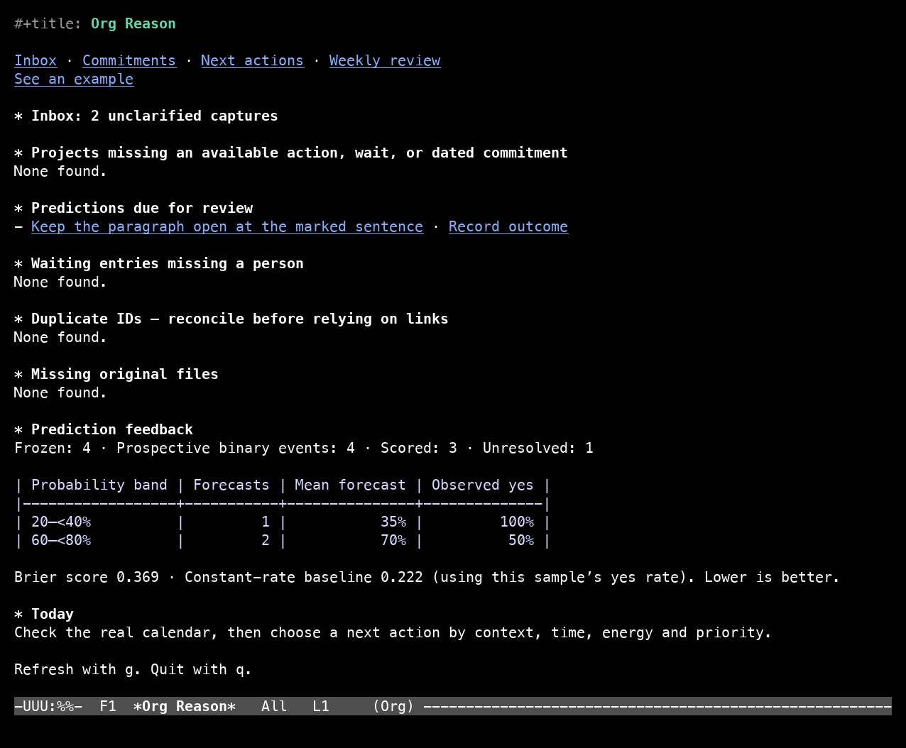

# Org Reason

[](https://github.com/dvdgdn/org-reason/actions/workflows/test.yml)



Org Reason keeps your inbox, next actions, and predictions in plain Org files.
It also supports [Reason Commons](https://reasoncommons.com/), a method and
shared record for reasoning about goals, causes, and proposed changes.

## Quick start

After [installing Org Reason](#install), try these commands.

1. `C-c r c` captures a thought, such as “Revise one German paragraph.”
2. `C-c r i` opens the inbox. Put point on that capture.
3. `C-c r x` clarifies it. Choose `next-action` and enter “Underline the sentence I’m least sure about.”

On the dashboard (`C-c r d`), **See an example** opens a fictional capture,
next action, and frozen prediction in a read-only Org buffer. Press `TAB` on
**Outcome** to reveal what happened. Press `q` to return. The same example
opens with `M-x org-reason-example`.

## Install

Org Reason requires Emacs 29.1 or newer. With Emacs 30, add this to your init.

```elisp
(use-package org-reason
  :vc (:url "https://github.com/dvdgdn/org-reason" :rev "v0.1.1")
  :custom
  (org-reason-directory "~/org/reason/")
  :config
  (org-reason-mode 1))
```

On Emacs 29, use `M-:` to evaluate
`(package-vc-install "https://github.com/dvdgdn/org-reason" "v0.1.1")`,
then omit the `:vc` line above. Both snippets install the latest tagged
release. To try the dashboard example and the other unreleased features
shown here, [install from a checkout](docs/install.md#1-the-package).

The Reason Commons commands need Python 3 and PyYAML. In a development
checkout, `M-x org-reason-setup-python` installs the Python requirements
into a virtual environment. The [installation guide](docs/install.md) covers
browser capture and using one workspace from several computers.

## Learn it

`C-c r ?` opens the command menu. Customize `org-reason-key-prefix` to
choose your own prefix, or set it to `nil` and use `M-x org-reason-menu`.
`C-c r h` opens the guided tutorial in a separate Emacs with a fictional
workspace. Tutorial progress is stored under `~/.emacs.d/org-reason-demo/`.

## Why

Experience should change what you do next. That needs a connection between **an
intention, a real attempt, useful feedback, and the next decision**.

Reason Commons supplies the conceptual discipline: goals, necessary conditions,
observations, causal claims, interventions, and explicit disagreement. GTD supplies
the operational discipline: capture, clarify, organize, reflect, engage. Org stores
and operates on the records; Org-roam, if you use it, supplies discovery and
backlinks. Emacs provides the interface. None needs to impersonate the others.

The system should help you answer:

1. What has my attention, and where can I put it down safely?
2. What have I actually committed to, and what can I do next?
3. What matters, and what might currently limit progress?
4. What did I expect, what happened, and what changes now?
5. Is this system itself earning the attention I give it?

## The operating loop

Capture a fragment immediately. Clarify commitments when processing the inbox.
When a recurring difficulty warrants investigation, make one bounded experiment:
state the prediction, preserve it before observing the outcome, act, compare, and
choose whether to continue, adjust, stop, or gather better evidence.

A shopping reminder can stop at a next action. A voice note can remain reference.
A language-practice session can stay a simple attempt with feedback. Elaborate
reasoning is available when it would change a consequential decision.

| Layer | Canonical record | What changes it |
|---|---|---|
| Capture and provenance | One identified Org subtree; original media bytes | Capture, then explicit clarification |
| Commitments | Ordinary Org tasks and project outcomes | Your decisions and task state changes |
| Knowledge | Identified headings in Org note files | Your writing, linking, and optional metadata |
| Formal reasoning | Native `reason-commons.yaml` per commons | Attributed proposals and explicit human endorsement |
| Learning | Experiment Org entry + original forecast snapshot + linked result | A prospective forecast, observations, and a new decision |
| Views | Agenda, dashboard, completion, Org outline, generated SVG | Rebuilt from canonical records |

## The few keys to learn first

| Key | Job |
|---|---|
| `C-c r c` | Capture a thought or selected region; no classification |
| `C-c r i` | Open the inbox |
| `C-c r x` | Clarify the inbox entry at point (`M-?` at any of its prompts explains it) |
| `C-c r C` | Capture, then clarify the new entry straight away |
| `C-c r a` | Projects, next actions, waiting, someday, and calendar view |
| `C-c r e` | Choose available actions by context, time, energy, then your priority |
| `C-c r d` | See exceptions: stalled projects, due predictions, missing originals |
| `C-c r w` | Open this week's review without erasing previous answers |
| `C-c r ?` | Discover commands in the menu |
| `C-c r E` | Open a worked example with a folded outcome |
| `C-c r h` | The guided tutorial, in a separate Emacs on fictional data |

When useful, add these:

| Key | Job |
|---|---|
| `C-c r m` / `C-c r I` | Import one original / process the drop directory |
| `C-c r D` | Explicitly run a configured local OCR or transcription adapter |
| `C-c r M` / `C-c r /` | Add optional metadata / find by property or tag |
| `C-c r A` | Archive completed single actions, keeping IDs and links |
| `C-c r !` | Capture “expected / observed” and stop there |
| `C-c r p`, `f`, `o` | Draft experiment, freeze original prediction, record outcome |
| `C-c r v` | Inspect an original forecast |
| `C-c r s` | Plan a component skill, challenge, feedback, and adjusted repetition |
| `C-c r t c` / `t v` | Create a commons / view it |
| `C-c r t n` / `t l` | Propose a node / relationship, including joint causes |
| `C-c r t a` / `t ?` | Endorse an identified item / add a challenge, assumption, or backlog item |
| `C-c r t g` / `t x` | Open accepted-reasoning diagrams / create one linked GTD action |

`M-x org-capture` also gains template `r` if that key is free; existing templates
are never replaced, and `C-c c` is not taken. The bookmarklet in
[capture/bookmarklet.html](capture/bookmarklet.html) sends a page and its selected
text straight to the inbox.

## A rhythm that earns its upkeep

- **During the day:** capture when needed; consult your actual calendar and available
  next actions. Use Org's clock only where actual time would inform a decision.
- **While clarifying:** decide whether an item is actionable. Process reference,
  discard, incubation, delegation, projects, and next actions distinctly.
- **Weekly:** complete the GTD review. Optionally examine due experiments and one
  recurring difficulty. Keep one next decision, not an expanding self-assessment.
- **Occasionally:** revisit goals and necessary conditions. Check whether the
  constraint moved and whether a practice skill transfers into ordinary work.
- **If the system becomes a burden:** remove optional fields and stop experiments
  temporarily. Quick capture and dependable commitments still work.

There is no streak, universal productivity score, automatic emotion inference, or
claim that training performance demonstrates general cognitive improvement.

## What is deliberately explicit

**Reason Commons interoperability is file compatibility.** The package edits the
actual conversational YAML v1 and uses a pinned upstream validator and offline
accepted-history renderer. It is not a client for a website API. A commons can be
edited by Emacs and another local tool in turn. Publication and live sync are
outside this release.

**Media capture preserves originals.** Record with your usual recorder, then import
the exported audio. Photograph or scan handwriting, then import the image.
Transcription and OCR are optional later steps. There is no built-in microphone
recorder, phone upload service, or bundled speech model.

**The installation is additive.** Turning the mode on creates the workspace if it
is missing and never replaces a file. It does not migrate existing notes, change
`org-roam-directory`, install packages, replace capture templates, schedule
background reviews, or publish data. If the workspace sits inside your Org-roam
directory, only its `knowledge/` notes are indexed, so captures and tasks don't
flood your notes (`org-reason-roam-knowledge-only`).

**Versioned memory is not tamper-proof evidence.** Package commands do not overwrite
frozen forecasts or prior snapshots. Files remain editable by their owner. A
supported prediction does not prove a unique causal explanation. Brier scores
cover only self-reported prospective, resolved binary events and display the
unscored count.

## Documentation

Start with the [hands-on user guide](docs/user-guide.org) (or `C-c r h`). It
contains a worked language-practice example, exact prompt answers, checkpoints,
lesson checkboxes, and a command/recovery reference.

| Read | For |
|---|---|
| [Install](docs/install.md) | Python, browser capture, OCR, several computers, Windows, backup and rollback |
| [Daily operation and a first experiment](docs/operating-guide.md) | Putting this into use without building another project |
| [GTD mapping](docs/gtd.md) | Decisions, lists, contexts, time, projects, horizons |
| [Directory and architecture](docs/architecture.md) | Canonical identity, module boundaries, recovery |
| [Metadata](docs/metadata.md) | Tags, properties, languages, feelings, failure classes |
| [Reason Commons contract](docs/reasoncommons.md) | Native schema, trees, AND, attribution, revisions |
| [Jobs and acceptance coverage](docs/jobs-and-acceptance.md) | JTBD, Gherkin, executable coverage and manual checks |
| [Customization](docs/customization.md) | Settings, adapters, Org-roam, other devices |
| [Sources](docs/sources.md) | Primary references and upstream revision |
| [Contributing](CONTRIBUTING.md) | Tests, layout, and extension rules |

## License

Original code is GPL-3.0-or-later ([LICENSE](LICENSE)). The pinned Reason Commons
files under `vendor/reasoncommons/` keep their MIT license and notice. No personal
records are part of this repository: they live wherever `org-reason-directory` points.
